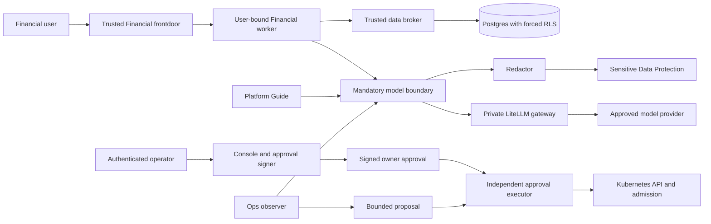

# Current platform architecture

This page describes the boundary-v2 source composition. A running release is identified by its selected `platform/clouds/gke/release-rc1.lock.json` and observed digests, not by the current branch name. Historical live reports qualify their recorded images and scope; they do not automatically qualify later source changes. Current evidence rules are in the [claims matrix](agent-platform/claims-matrix.md).

## Trust boundaries

### Network

Agents cannot reach the internet or each other. Every agent namespace starts from a default-deny NetworkPolicy for ingress and egress; the release then allows only DNS and the platform services that agent needs (the model gateway boundary, the redactor and, for the Financial workers, the data broker). No egress rule points at an address range and the cluster has no Cloud NAT, so there is no route out. Calls to Google's model and DLP APIs leave only from the platform's model gateway and redactor, through private endpoints for the named Google hostnames. Agent Pods also cannot reach the database, the private model provider gateway, the approval executor, the Kubernetes API or the cloud metadata server.

### Model gateway

Every model request from an agent passes three parts in order. `gateway-boundary` accepts a bounded request and authenticates the calling agent. `redactor` masks supported identifier patterns in each message. Only then does the private `gateway` (LiteLLM) call the model provider, with an upstream credential scoped to that agent. Identifiers are masked before a request leaves the cluster.

Workers' public gateway credentials do not authenticate directly to the private LiteLLM service. `agent_platform.gateway_boundary.GatewayBoundary` validates the alias and message shape, redacts each accepted message, discards caller-supplied request metadata and generates its own request ID before dispatch. Failure refuses the affected call. Client-side masking is additional protection, not the enforcement authority for a hostile worker.

The redactor uses the existing qualified pattern set and Sensitive Data Protection adapter. **Person names and passport numbers are not masked.** Supported patterns cover email, supported phone/card/IBAN formats, labelled bank accounts and supported Saudi national-ID, residence-ID and VAT/tax-ID formats. Matching depends on format and context. `agent_platform.masking_scope` supplies the exact eight categories and limitations to the Financial UI. This is not a promise to hide every kind of personal information.

### Data broker

`finance_agent.frontdoor` runs as the trusted `apps/financial-frontdoor` service. It owns sign-in, signed sessions, CSRF checking, user expense entry and per-user worker routing. It issues a short-lived capability for an authenticated user's bound worker and revokes it after the turn.

The broker endpoint checks caller identity, capability signature, active status, expiry, agent binding and user binding before running registered read-only tools. Workers hold neither database credentials nor session/signing keys. They have no direct Postgres network path. The broker selects `finance.user_id` in a transaction; forced row-level security and non-owner, NOBYPASSRLS roles provide the database layer. The trusted web role can insert the authenticated user's expenses; the worker's tools cannot write. Arbitrary additional data agents require a reviewed broker contract, rather than receiving shared database credentials.

### Approval executor

Only the independent approval executor (`ops-executor`) can execute an approved change, and only after the owner signs the approval. The Ops agent reads observations and proposes actions. It has no workload mutation authority. The trusted app signs the owner's approval; the independent `ops-executor` authenticates and verifies it, checks the registered action/target and current evidence, and performs the bounded patch. RBAC and admission restrict this identity to declared targets and allowed restart/scale changes. Model explanations are display-only and do not grant authority.

`platform/core/src/agent_platform/ops/authority.json` declares managed roles, exact bindings and subjects. Generated RBAC and posture comparison use this inventory. Unexpected subjects are findings. Read-only targets, including Financial workers and the executor itself, cannot become remediation targets merely because a finding exists.

### Request events

Platform components emit bounded request events, and workers return trace metadata with each answer. These are not a complete, independently joined or durable audit of every request. Worker trace fields do not prove enforcement by the broker or model boundary. [Request trace](platform/request-trace.md) describes their actual scope.

## Infrastructure and release

The GKE workload network uses private nodes, default-deny policies and explicit paths. Model-provider and DLP connectivity use declared Google/private endpoint routes. DNS, including the declared node-local DNS path, is part of the rendered policy. Resolver access is not proof that DNS exfiltration is impossible. Engineering VMs are outside this workload boundary.

Onboarding renders platform-owned namespace, quota, policy, service account and workload controls. `make up` selects the release lock, renders typed release values and applies the reviewed stages; it does not repair rendered YAML with text substitutions. Readiness compares desired and running image digests and requires actual ready resources. A down cluster is not ready.

Image signatures, KMS attestations, source provenance and live qualification have distinct meanings. The [release policy](security/container-vulnerability-release-policy.md) defines the unchanged vulnerability gate. The final release procedure freezes source, builds its first-party images, verifies their evidence, promotes a metadata-only lock and deploys those exact digests. A new live assessment must identify those same images.

See [known limitations](security/known-limitations.md), [onboarding](agent-developer-guide.md), [Ops](console/operations.md) and the [recording runbook](operations/demo-runbook.md).
